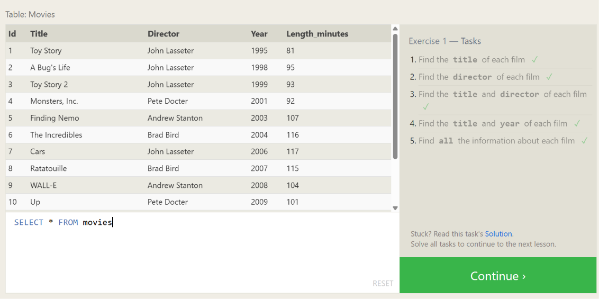

# 🛡️ Apprentissage du SQL pour la Cybersécurité

Ce dépôt rassemble mes travaux pratiques, mes scripts de requêtes et mes exercices d'entraînement en SQL, dans le cadre de ma préparation aux métiers de la cybersécurité (SOC / Blue Team).

---

## 📁 Structure du Projet

- `01_creation_et_insertion.sql` : Création de la structure de la table `utilisateur` (DDL) et insertion de jeux de données fictifs (DML).
- `02_selection_et_filtrage.sql` : Requêtes d'interrogation et de filtrage de données (`WHERE`, `LIKE`, `BETWEEN`, `IN`).
- `03_sqlbolt_lesson1.sql` : Exercices pratiques de sélection validés sur la plateforme SQLBolt.
- `screenshots/` : Captures d'écran de validation et preuves d'exécution.

---

## 📌 Compétences SQL Validées

- **DDL (Data Definition Language) :** `CREATE TABLE`, gestion des types de données (`VARCHAR`, `INTEGER`, `DATE`, `BOOLEAN`).
- **DML (Data Manipulation Language) :** `INSERT INTO`, gestion des données de test.
- **DQL (Data Query Language) :** `SELECT`, `WHERE`, filtres de texte (`LIKE '%...'`), filtres d'intervalles (`BETWEEN`).

---

## 📸 Preuves de Pratique (SQLBolt)

### Leçon 1 : Requêtes SELECT simples

---

> **Note de sécurité :** Toutes les données (noms, e-mails) présentes dans les scripts sont strictement fictives et créées uniquement à des fins d'entraînement.